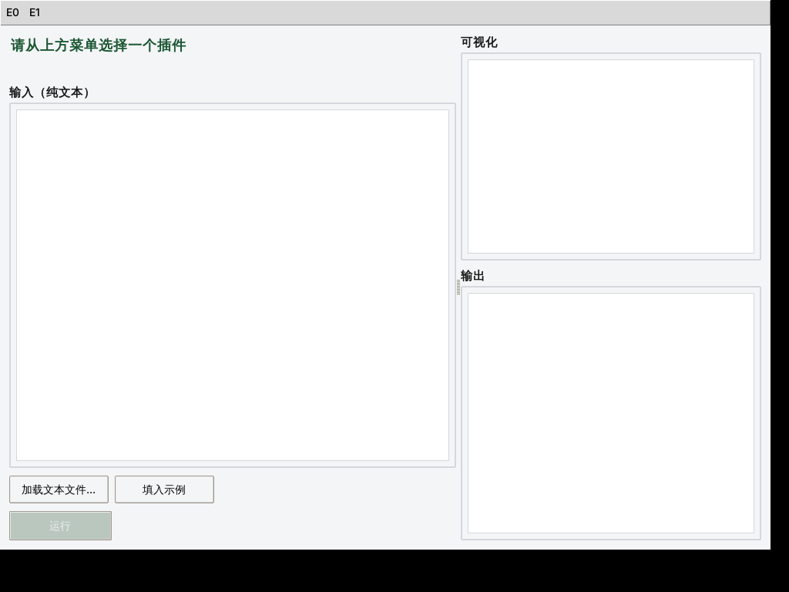
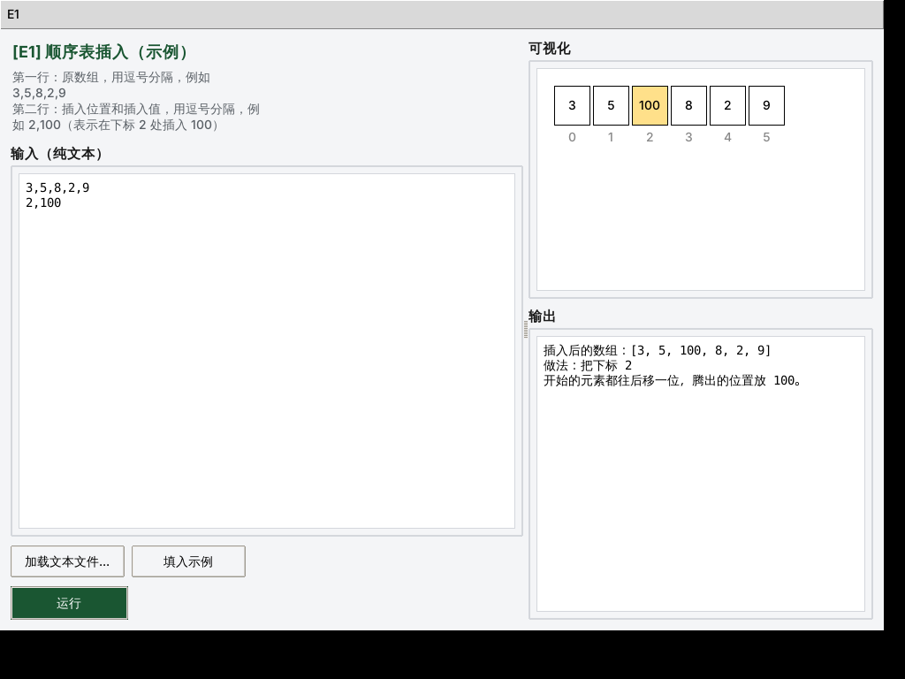

# 数据结构实验课程 —— 插件式集成平台

第一次打开这个仓库，建议按这个顺序看：

1. [`docs/getting_started.md`](docs/getting_started.md)：先把环境装好，跑一遍平台自带的示例，照着做就行。
2. [`docs/student_manual.md`](docs/student_manual.md)：插件接口怎么写、常见问题都在这里。
3. [`docs/lab1.md`](docs/lab1.md)：实验一要做什么、输入输出格式、测试数据、提交要求。
4. [`docs/architecture.md`](docs/architecture.md)：平台内部是怎么运作的，选读，写插件用不上。

其他文档：
- [`docs/course_design.md`](docs/course_design.md)：课程设计，每次课讲什么、怎么评分，给老师用的。
- [`docs/plugin_platform_guide.html`](docs/plugin_platform_guide.html)：一页纸的图文总览，下载后拿浏览器打开（GitHub 网页只显示源码，不会渲染）。
- [`platform-python/`](platform-python/)、[`platform-c/`](platform-c/)：两版平台的代码。

两版平台都带一个空白模板（`template/`）和一个示例 `plugins/example_insert`（顺序表插入与删除，带可视化）。复制模板去写自己的插件就行。

## 界面预览（Python 版）

| 顶部菜单栏（按实验分组） | 运行结果（含可视化画布） |
| --- | --- |
|  |  |

更多截图和操作步骤看 [`platform-python/README.md`](platform-python/README.md)。
