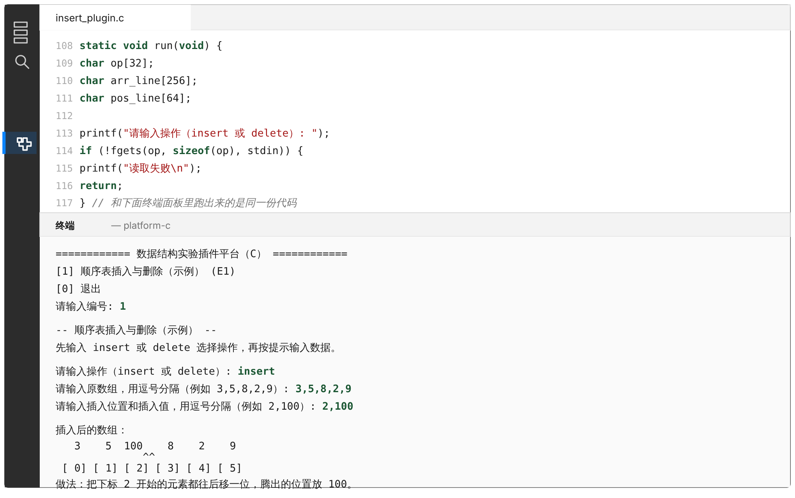

# 快速开始：从零到看到平台跑起来

跟着下面的步骤做，全程点 VSCode 里的按钮就行，不用自己敲命令（装编译器那一步除外，就一行命令，复制粘贴）。

Python 版和 C 版选一个装，不用两个都装。拿不准选哪个的话，Python 版上手快一些，C 版更贴近数据结构课本身常用的语言。

## 第一步：装 VSCode

去 https://code.visualstudio.com/ 下载安装，Windows / macOS / Linux 都有，装完打开它。

## 第二步：装好对应版本需要的东西

### 选 Python 版

1. 装 Python（≥ 3.10）。
   - Windows：去 https://www.python.org/downloads/ 下载安装包，装的时候一定要勾选 "Add python.exe to PATH"，这步漏了后面全乱。
   - macOS：系统自带的版本一般太旧，去官网下最新版。
   - Linux：发行版大多自带，终端跑一下 `python3 --version` 看版本号够不够。
2. 用 VSCode 打开 `platform-python` 这个文件夹——文件 → 打开文件夹，选的是这个子文件夹，不是整个仓库。
3. 右下角通常会提示装推荐的扩展，点安装。没弹出就手动装：左侧竖排图标里找扩展图标（下图①），搜 `Python`（发布者 Microsoft），装上。
4. `Ctrl+Shift+P`（macOS 是 `Cmd+Shift+P`），输入 `Python: Select Interpreter`，选刚装的那个 Python。

没用过 VSCode，不认得这两个图标？看这张图，扩展图标在左下角，运行按钮在编辑器右上角，C 版也会用到：


### 选 C 版

1. 装编译器，按自己的系统选一条命令，复制粘贴到终端跑一次：

   | 系统 | 命令 |
   |---|---|
   | Windows（PowerShell） | `winget install -e --id MSYS2.MSYS2` |
   | macOS（终端） | `xcode-select --install` |
   | Linux（终端） | `sudo apt install build-essential gdb` |

   Windows 多一步：装完 MSYS2，打开开始菜单的 "MSYS2 UCRT64"，在它的窗口里跑 `pacman -S mingw-w64-ucrt-x86_64-gcc`，然后把安装路径下的 `ucrt64\bin` 加进系统环境变量 PATH（网上搜"windows 添加环境变量"就有步骤）。这一步做完就不用再管了。

   > `winget` 命令找不到？Windows 10 1809 之后的版本都自带，更新一下系统就行；实在不行去 https://www.msys2.org/ 手动下安装包，跟着官网首页走。

2. 用 VSCode 打开 `platform-c` 文件夹。
3. 同样，右下角提示装推荐扩展就点安装（或者手动搜 `C/C++`，发布者 Microsoft）。
4. 打开 `plugins/example_insert/insert_plugin.c` 这个文件看一眼，VSCode 这时候可能弹出"选择编译器"的提示，列表里可能好几个选项，别纠结——我们用 `make` 编译，不依赖这个选择，随便选一个或者直接关掉都没事。想消掉代码里的红色波浪线，就选路径里带着你刚装的那个编译器的那一项（比如 `ucrt64\bin\gcc.exe`）。

## 第三步：运行起来

Python 版打开 `main.py`，点编辑器右上角的 ▶（或按 `F5`），会弹出一个图形界面窗口，单独的一个窗口，跟 VSCode 本身是分开的。C 版不一样，没有弹出窗口这回事：直接按 `F5`，VSCode 先编译，然后就在它自己下方的"终端"面板里显示一个文字菜单，所有输入输出都在这个面板里完成。

看到下面这样就是成功了。

Python 版（弹出的图形界面窗口）：


C 版（VSCode 自带的终端面板，运行 insert 操作的效果）：



这张图是照着真实运行结果画的示意图，不是 VSCode 的实拍截图——这个环境里下载不了 VSCode 本体，没法截到真图。但终端里的文字、交互顺序都是从实际编译运行的程序里原样抄出来的，跟你电脑上跑出来的应该一模一样。

### C 版没有图形界面，是故意的

C 版自始至终就是纯文本菜单，不是哪个版本漏做了界面。原生 C 做图形界面得靠 GTK、Qt 这类第三方库，或者 Windows/macOS 各自的系统 API，装起来麻烦、还只能在一个系统上用，跟"三个系统编译命令一样"这个目标冲突，所以干脆不做。

没有界面不代表没有"插件式"——插件式说的是代码怎么组织，不是长什么样子。每个插件注册的时候把自己的名字和一个函数绑在一起，核心程序维护一份列表，把列表打印成编号菜单：

```
[1] 顺序表插入与删除（示例） (E1)
[2] 你写的某个算法 (E2)
[0] 退出
请输入编号:
```

输入编号，核心程序就调用那个插件对应的函数——这跟图形界面里"点一下按钮触发对应插件的代码"是同一件事，只是触发方式从鼠标点击换成了打数字回车，菜单本身就是这个版本的"界面"。新增一个插件，核心程序的代码一行都不用改，这一点 Python 版和 C 版是一样的，想知道具体怎么做到的看 [`architecture.md`](architecture.md)。

## 卡住了怎么办

Python 提示找不到 `tkinter`，Linux 上比较常见，执行 `sudo apt install python3-tk` 再重新运行。C 版编译报错，先确认编译器真的装好了（终端跑 `gcc --version` 能看到版本号），没装好就回第二步重来，装好了再看 VSCode 终端里具体报的什么错。

查了还是没头绪，找助教，别自己瞎猜太久。

## 下一步

平台跑起来之后看 [`student_manual.md`](student_manual.md)，讲怎么写自己的插件。想知道平台内部是怎么运作的，看 [`architecture.md`](architecture.md)，不过写插件用不上这篇。
