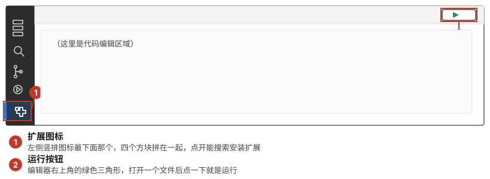
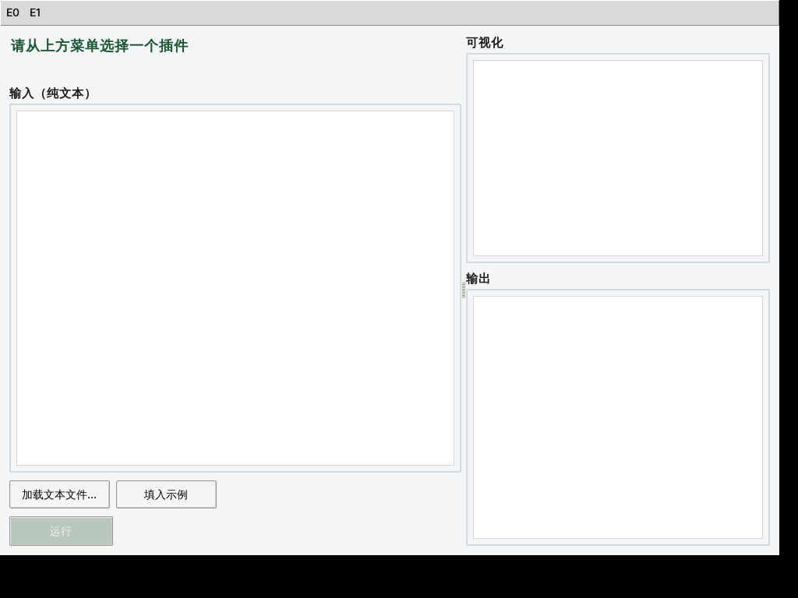

# 快速开始：从零到看到平台跑起来

照着下面的步骤一步步做，全程只需要点 VSCode 里的按钮，不需要自己敲命令（装编译器那一步除外，就一行命令，复制粘贴即可）。

Python 版和 C 版选一个就行，不用两个都装。拿不准选哪个：Python 版更快上手；C 版更贴近"数据结构"课本身常用的语言。

## 第一步：装 VSCode

前往 https://code.visualstudio.com/ 下载安装，Windows / macOS / Linux 都有。装完打开它。

## 第二步：装好对应版本需要的东西

### 选 Python 版

1. 装 Python（≥ 3.10）：
   - Windows：去 https://www.python.org/downloads/ 下载安装包，安装时**务必勾选 "Add python.exe to PATH"**。
   - macOS：系统自带的 Python 版本太旧，去官网下载安装最新版。
   - Linux：发行版一般自带，终端执行 `python3 --version` 看看版本号够不够。
2. 用 VSCode 打开 `platform-python` 这个文件夹（文件 → 打开文件夹，注意选的是这个子文件夹，不是整个仓库）。
3. 右下角会提示装推荐的扩展，点"安装"。如果没弹出，手动装：点左侧竖排图标里的扩展图标（下图①），搜 `Python`（发布者 Microsoft），点安装。
4. 按 `Ctrl+Shift+P`（macOS 是 `Cmd+Shift+P`），输入 `Python: Select Interpreter`，选你刚装的 Python。

没用过 VSCode、不认识这两个图标的话看这张图（扩展图标在左下角，运行按钮在编辑器右上角，下面 C 版也会用到）：



### 选 C 版

1. 装编译器，三选一，对应你的系统，复制粘贴到终端执行一次就行：

   | 系统 | 命令 |
   |---|---|
   | Windows（PowerShell） | `winget install -e --id MSYS2.MSYS2` |
   | macOS（终端） | `xcode-select --install` |
   | Linux（终端） | `sudo apt install build-essential gdb` |

   Windows 额外多一步：装完 MSYS2 后，打开开始菜单里的 "MSYS2 UCRT64"，在弹出的窗口里执行 `pacman -S mingw-w64-ucrt-x86_64-gcc`，装完把安装路径下的 `ucrt64\bin` 目录加进系统环境变量 PATH（网上搜"windows 添加环境变量"，步骤都差不多）。这一步装好之后不用再管。

   > 找不到 `winget` 命令：Windows 10 1809 之后的版本都自带，更新一下 Windows 即可；实在不行就去 https://www.msys2.org/ 手动下载安装包，步骤跟着官网首页走。

2. 用 VSCode 打开 `platform-c` 这个文件夹。
3. 右下角提示装推荐扩展时点"安装"（或手动搜 `C/C++`，发布者 Microsoft，图标位置见上面那张图）。
4. 打开任意一个 `.c` 文件时，VSCode 可能会弹出"选择编译器"（Select a Kit / Configure IntelliSense）的提示，列表里可能有好几个选项。这个跟实际编译没关系——我们用 `make` 编译，不依赖这个选择，随便选一个或者直接关掉提示都行；想消除代码里的红色波浪线提示，就选路径里带你刚才装的那个编译器（比如 `ucrt64\bin\gcc.exe`）的那一项。

## 第三步：运行起来

- **Python 版**：打开 `main.py`，点编辑器右上角的 ▶ 按钮（或按 `F5`）。会弹出一个图形界面窗口。
- **C 版**：直接按 `F5`。VSCode 会先编译，再在下方"终端"面板里显示一个文字菜单。

看到下面这样就说明成功了：

**Python 版**（图形界面）：



**C 版**（文字菜单，直接在 VSCode 下方终端里看到）：
```
============ 数据结构实验插件平台（C） ============
  [1] 顺序表插入（示例） (E1)
  [0] 退出
请输入编号:
```

## 卡住了怎么办

- Python 提示找不到 `tkinter`（Linux 比较常见）：执行 `sudo apt install python3-tk`，装完重新运行。
- C 版编译报错：先确认第二步的编译器装好了（终端执行 `gcc --version` 能看到版本号），再看 VSCode 下方"终端"面板里具体的报错信息。
- 其他问题找助教，不要自己瞎猜太久。

## 下一步

环境跑起来之后，去看 [`student_manual.md`](student_manual.md)，里面讲怎么写自己的插件。想知道这个平台内部是怎么运作的，看 [`architecture.md`](architecture.md)。
