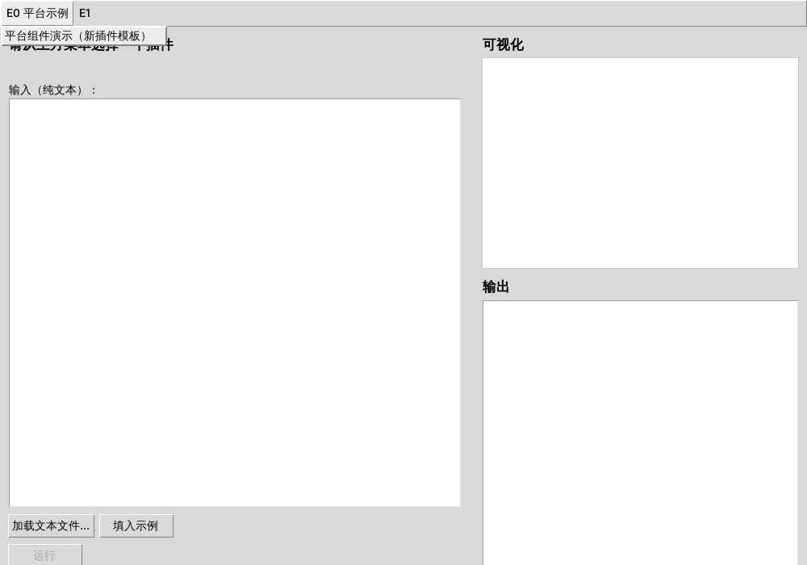
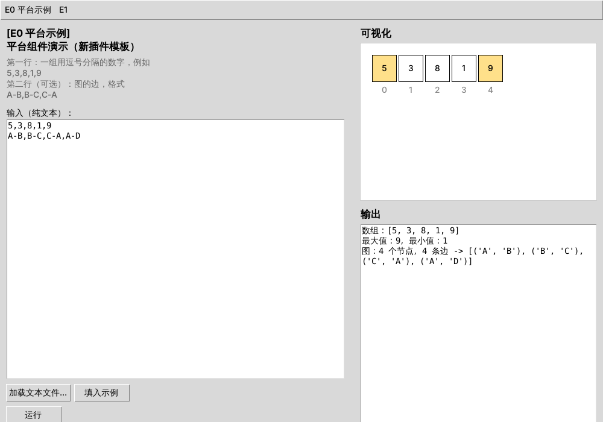

# 数据结构实验插件平台（Python 版）

不熟悉命令行？用 VSCode 打开这个文件夹，打开 `main.py` 点右上角 ▶ 即可运行，详见 [`../docs/vscode_setup.md`](../docs/vscode_setup.md)。

命令行方式：
```bash
python3 main.py
```

依赖：Python ≥ 3.10，标准库 `tkinter`（无需 `pip install`）。若提示找不到 `tkinter`，Linux 下用包管理器安装 `python3-tk`。

## 操作步骤

1. **打开某次课的菜单**：顶部菜单栏按实验编号分组（`E0` 是平台组件演示，`E1`、`E2`……是各次实验），点开对应菜单能看到这次课所有已加载的插件。

   

2. **选中一个插件**：点菜单里的插件名，左侧会出现这个插件的说明和一个纯文本输入框。

3. **准备输入**：可以直接在输入框里打字，也可以点"填入示例"一键填入插件自带的示例，或者点"加载文本文件..."从一个 `.txt` 文件读入。

4. **运行**：点"运行"，中间上方的画布会显示可视化结果（如果插件调用了可视化工具），下方输出框显示文字结果。

   

插件接口规范、如何新增插件、可视化工具用法、常见问题：见 [`../docs/student_manual.md`](../docs/student_manual.md)。
**新插件从这里开始**：[`plugins/example_demo/plugin.py`](plugins/example_demo/plugin.py)（E0，演示了数组方格/柱状图/图三种可视化画法，复制整个目录改名即可）。
另附一个无需可视化的示例：[`plugins/example_recursion/plugin.py`](plugins/example_recursion/plugin.py)（E1 汉诺塔）。
